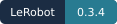
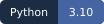
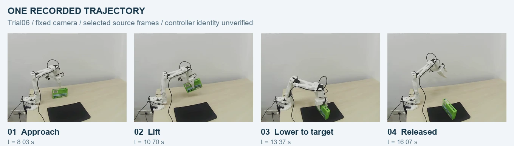
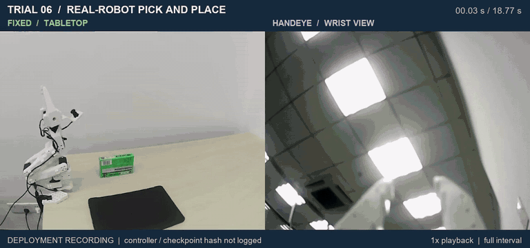
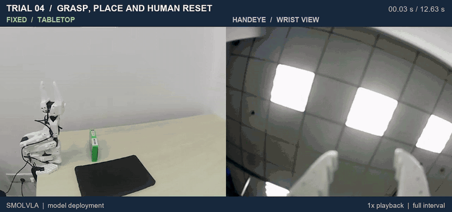
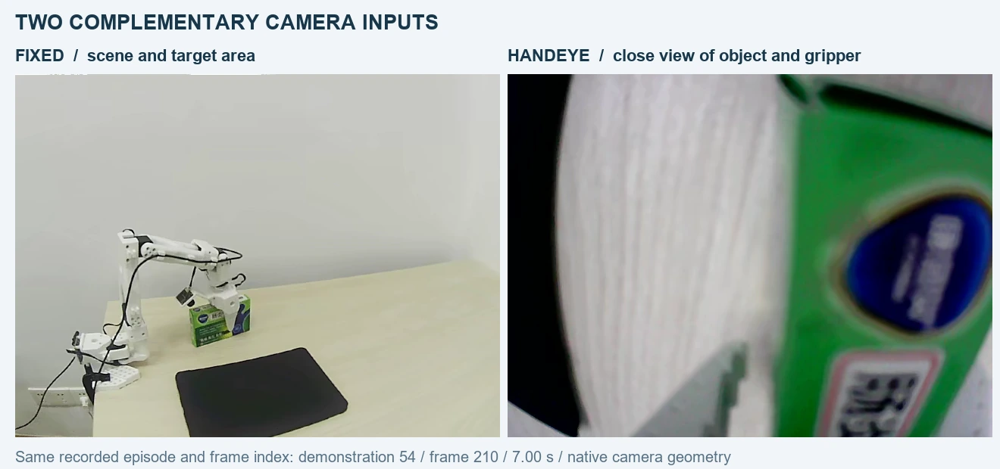
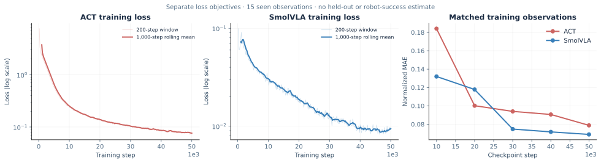

<h1 align="center">SO-101 Imitation Learning</h1>
<p align="center"><strong>Real-to-real learning · physical demonstrations, ACT / SmolVLA, and robot deployment</strong></p>
<p align="center">
  
  
  
  
</p>

This project uses an **SO-101 leader–follower pair**, two RGB cameras, and the existing LeRobot training stack to learn one physical task:

> Pick up the green medicine box and place it in the black target area.

The experiment includes real teleoperation data, **ACT and SmolVLA checkpoints trained to 50,000 steps**, and real-robot deployment recordings. ACT training and the surviving deployment videos date to **September 29, 2026**; SmolVLA training and the analysis tools date to **October 7–13, 2026**. See the [recorded timeline and source provenance](docs/so101/provenance.md).

<p align="center"><strong>🧭 Contents</strong></p>

<p align="center">
  <a href="#demo">🎬 Demo</a> &nbsp;·&nbsp;
  <a href="#features">✨ Main features</a> &nbsp;·&nbsp;
  <a href="#architecture">🧩 System architecture</a>
</p>
<p align="center">
  <a href="#collection">🎮 Data collection</a> &nbsp;·&nbsp;
  <a href="#training">🧠 Training &amp; deployment</a> &nbsp;·&nbsp;
  <a href="#remote-training">☁️ Remote GPU training</a>
</p>
<p align="center">
  <a href="#results">📈 Experimental results</a> &nbsp;·&nbsp;
  <a href="#quickstart">🚀 Quick start</a> &nbsp;·&nbsp;
  <a href="#structure">📂 Project structure</a> &nbsp;·&nbsp;
  <a href="#credits">📚 Citation &amp; license</a>
</p>

<p align="center"><sub>Jump to a section above. Full commands and troubleshooting live in the linked guides.</sub></p>

<a id="demo"></a>
## 🎬 Demo

<p align="center">
  <a href="media/so101/deployment-trial06-telemetry.mp4?raw=true"></a>
  <br><sub>Trial06 · real cameras + recorded joint motion · full 18.77 s · 1× playback · no time cuts</sub>
</p>

**[Download video + telemetry MP4](media/so101/deployment-trial06-telemetry.mp4?raw=true)** · [Recorded samples](results/so101/telemetry/trial06.csv) · [Alignment checks and sources](results/so101/telemetry/trial06.json)

Watch the grasp alongside all six joints: **solid teal is measured position; dashed amber is the sent target**. The histories reveal each recorded sample as the moving time cursor reaches it. These are the trial's actual `observation.state` and `action` values, paired with video presentation timestamps and frame indices. This is synchronized playback of existing records. Position follows the calibration-normalized servo convention; no motor-current or torque traces were recorded. [How the synchronization works](docs/so101/media.md#video-and-joint-motion).

The fixed camera shows the complete pick-and-place; the wrist view shows the approach and object close up. **The handeye recording ends at 14.20 s**: a text card marks the remaining 4.57 s while the fixed view continues. Views are paired by recorded frame index; hardware exposure synchronization was not measured.

The source directory identifies **050000**, but does not store a controller name or checkpoint hash. **ACT versus SmolVLA and autonomous-control provenance remain unverified**. The export keeps the full fixed-camera interval, including the initial wait. This selected trajectory is separate from task-success statistics.

<p align="center"></p>

<details>
<summary>More camera footage: full-size two-view recording and a second deployment</summary>

<p align="center">
  <a href="media/so101/deployment-trial06-two-view.mp4?raw=true"></a>
  <br><sub>Trial06 · equal-size camera views · full 18.77 s · 1× · no time cuts</sub>
</p>

[Download two-view MP4](media/so101/deployment-trial06-two-view.mp4?raw=true) · [Native fixed-camera MP4](media/so101/deployment-trial06.mp4?raw=true) · [Larger fixed-camera display copy](media/so101/deployment-trial06-display-1280.mp4?raw=true).

<p align="center">
  <a href="media/so101/deployment-trial04-two-view.mp4?raw=true"></a>
  <br><sub>Trial04 · both complete camera streams · full 12.63 s · 1× · human cable handling and reset retained</sub>
</p>

[Download trial04 MP4](media/so101/deployment-trial04-two-view.mp4?raw=true). This is another **deployment recording**, with the same missing controller/checkpoint identifiers. Human interaction is visible and retained. [Human demonstration footage](#collection) is labeled separately below; [failure observations](#results) are included with the evaluation scope.

</details>

[Media manifest](results/so101/media_manifest.json) records source hashes, frame counts, and processing. Demonstration replay and scripted control are not presented as learned-policy footage.

<a id="features"></a>
## ✨ Main features

- **Physical demonstration collection:** SO-101 leader input, follower execution, two camera streams, six joint positions, and the actions actually sent to the follower.
- **Two trained policies:** ACT with a ResNet-18 visual backbone and 100-step action chunks; SmolVLA with two-view image/state input, task text, and 50-step action chunks.
- **Local deployment tools:** strict checkpoint loading, saved normalization buffers, an offline compatibility check, and a SmolVLA live inference runner with explicit execution mode.
- **Hardware integration changes:** selectable OpenCV capture codec, SO-101 serial retry settings, and empty-episode recording handling. Existing dual-arm integration code is retained but was not evaluated in this single-arm experiment.
- **Traceable results:** original loss CSVs, compact saved predictions, checkpoint hashes, a complete training-data audit, and scripts to recompute diagnostics.
- **Recorded motion in context:** real camera footage synchronized with six measured joint positions and sent targets, with the selected sample table and timestamp checks included.

<a id="architecture"></a>
## 🧩 System architecture

<p align="center"></p>

| Component | Experiment configuration |
| --- | --- |
| Robot | SO-101 follower, with SO-101 leader for demonstrations |
| Camera inputs | `observation.images.fixed` and `observation.images.handeye` |
| Recorded video | RGB, 640 × 480, 30 FPS, AV1, no audio |
| State / action | Six joint-position values in the same recorded order |
| Dataset format | LeRobot **v2.1**, per-episode Parquet and per-camera MP4 |
| Training | Saved Linux training configs; batch size 4, seed 1000, 50,000 steps |
| Local inference evidence | Windows, Python 3.10, PyTorch 2.7.1 + CUDA 12.8, GTX 1650 Ti |

Training and deployment must agree on camera names, view assignment, image shape, joint order, calibration convention, and normalization buffers. [Configuration relationships](docs/so101/deployment.md#configuration-contract) explains each dependency.

### What the policy sees

<p align="center"></p>

The fixed view covers the work area and target; the moving handeye view provides a close view during grasping. These are the actual two inputs stored under `observation.images.fixed` and `observation.images.handeye`. The camera images retain their recorded orientation and field of view.

<a id="collection"></a>
## 🎮 Data collection

The leader controls the follower while LeRobot records images and joint readings in each control iteration. The dataset stores the **action returned by `robot.send_action`**, so clipped targets are recorded as sent.

<p align="center">
  <a href="media/so101/teleoperation-episode54.mp4?raw=true"></a>
  <br><sub>Human teleoperation · training episode54 · full 12.23 s · 1× playback · no time cuts</sub>
</p>

[Download demonstration MP4](media/so101/teleoperation-episode54.mp4?raw=true). The human drives the leader arm; this training episode is not a policy rollout.

| Training data | Verified value |
| --- | ---: |
| Demonstration episodes | 55 |
| Recorded control frames | 20,512 |
| Two-view video files | 110 |
| Recorded time | 11.40 min |
| Episode duration | 9.30–13.37 s |
| Metadata split | `train: 0:55` |

All 55 Parquet files and all 110 videos pass the [saved audit](results/so101/dataset/audit.json), including decoded video frame counts. The dataset name contains `20s`; actual episode durations come from the records. The two views share dataset timestamps; hardware exposure synchronization was not measured.

The full dataset remains outside Git. Use the [collection and data guide](docs/so101/data.md) for calibration, recording, readback, and dataset validation commands.

<a id="training"></a>
## 🧠 Training and deployment

| Setting | ACT | SmolVLA |
| --- | --- | --- |
| Actual final step | 50,000 | 50,000 |
| Native action chunk | 100 steps | 50 steps |
| Batch size / seed | 4 / 1000 | 4 / 1000 |
| Learning rate | `1e-5` | `1e-4`, warmup + cosine decay |
| Image normalization | ImageNet mean/std | Identity at policy input; internal image processing |
| State / action normalization | Mean/std | Mean/std |
| Checkpoint interval | 10,000 steps | 5,000 steps |
| Task text input | Not used by ACT | Exact recorded instruction |

The original trainer, dataset loader, policy implementations, optimizer handling, and checkpoint resume mechanism are retained. [Training instructions](docs/so101/training.md) distinguish archived settings, a fresh-training recipe, and exact checkpoint resume. The saved SmolVLA config does not establish its original initialization source.

<a id="remote-training"></a>
### ☁️ Train on a remote GPU server

Both policies were trained on a **remote Linux GPU server**. The local robot computer collects demonstrations and runs deployment; the server trains from a copy of the same dataset and repository. Robot ports and private calibration stay on the robot computer.

| Robot computer | Remote training server |
| --- | --- |
| Collect and audit the fixed/handeye demonstrations | Reuse a compatible GPU environment; copy and validate the dataset |
| Keep robot calibration and camera mapping | Train ACT or SmolVLA with the exported settings |
| Receive the complete checkpoint and run an offline check | Save logs, optimizer/scheduler state and checkpoint hashes |
| Connect the follower for physical deployment | Return the checkpoint without publishing weights |

```bash
# In this repository on the server, with the dataset in the sibling datasets/ directory.
python -m lerobot.scripts.train --config_path=configs/so101/train_act.json --output_dir=outputs/train/act_cloud_50k
python -m lerobot.scripts.train --config_path=configs/so101/train_smolvla.json --output_dir=outputs/train/smolvla_cloud_50k
```

Run the two jobs separately on a single GPU. The **[remote GPU training walkthrough](docs/so101/remote-training.md)** covers environment checks, data transfer, pretrained assets, persistent sessions, loss logs, exact resume and checkpoint transfer back to the robot. The original server GPU and full environment lock were not retained; the guide labels the current compatible recipe separately from the historical run.

Deploy ACT using `python -m lerobot.record --policy.path=...`; use the migrated `scripts/so101/run_policy.py` for the existing offline SmolVLA loading path, or the standard recorder when rollout recording is needed. The runner is synchronous: it pauses to generate each new action chunk. A 30 FPS target does not establish a measured 30 Hz end-to-end control rate. [Deployment guide](docs/so101/deployment.md).

<a id="results"></a>
## 📈 Experimental results

<p align="center"></p>

**Post-training diagnostics on training observations:** 5 episodes × 3 observations, matched across models; future 50-step predictions scored against recorded actions. nMAE and nRMSE divide each joint error by the same training-action standard deviation.

| 50k checkpoint | nMAE ↓ | nRMSE ↓ | Mean joint R² ↑ |
| --- | ---: | ---: | ---: |
| ACT | 0.07877 | 0.13021 | 0.97642 |
| SmolVLA | 0.06887 | 0.12566 | 0.97702 |

These measurements describe action fitting on **seen training observations**. R² is not classification accuracy, and these values are not grasp-success rates. Loss objectives differ between models, so their absolute training losses are plotted separately.

<details>
<summary>Inspect the six-joint action chunks</summary>

<p align="center"></p>

This is the middle of the 15 retained observations: **episode26, approximately halfway through the episode**. Both 50k checkpoints predict the same next 50 recorded steps from one observation. The curves come directly from the included prediction arrays; they are offline predictions, not executed robot trajectories. Position units follow the recorded normalized servo convention. [Reproduce the plots](docs/so101/evaluation.md).

</details>

| Physical evaluation item | Recorded result |
| --- | --- |
| Successful autonomous trials / attempted autonomous trials | — / — |
| Consistent, predefined success protocol | Not recorded |
| Conditions visible in videos | Same tabletop and black target; box pose varies |
| Failure observations | Box knocked over; no completed pickup within clip; incomplete camera recordings |
| Independent held-out split | Not recorded; all 55 demonstration episodes were used for training |

Surviving deployment artifacts are listed [trial by trial](docs/so101/evaluation.md). A missing denominator, incomplete recordings, and absent controller identifiers prevent a defensible success-rate estimate. The [evaluation protocol and blank outcome sheet](results/so101/physical_trials.csv) provide the fields needed for a future measured evaluation.

<details>
<summary>Inspect a failure recording: box tips before a completed placement</summary>

<p align="center">
  <a href="media/so101/deployment-trial03-two-view.mp4?raw=true"></a>
  <br><sub>Trial03 · deployment recording · controller identity unverified · full 12.23 s · 1×</sub>
</p>

[Download failure MP4](media/so101/deployment-trial03-two-view.mp4?raw=true). The box tips and no placement is completed within the saved interval. A human hand appears at the end. This qualitative observation is not assigned an autonomous success/failure label without the missing control log.

</details>

<a id="quickstart"></a>
## 🚀 Quick start

Run commands from this repository root in the existing Python 3.10 environment, or install the pinned compatibility profile. Install a PyTorch wheel suitable for the host; the recorded Windows GPU environment used CUDA 12.8.

```bash
python -m pip install torch==2.7.1 torchvision==0.22.1 --index-url https://download.pytorch.org/whl/cu128
python -m pip install -e ".[feetech,smolvla]" -c requirements-so101.txt
python -m pip check

# Recompute the included results; no robot, weights, or full dataset required.
python scripts/so101/verify_results.py

# Validate an existing local dataset, without modifying it.
python scripts/so101/audit_dataset.py --root ../datasets/medicine_box_black_5_20s_v1 --decode-videos

# Train ACT from the exported experiment configuration.
python -m lerobot.scripts.train --config_path=configs/so101/train_act.json
```

Weights and full demonstrations are not distributed in this Git source release. Training requires your dataset; inference requires the matching `config.json` and `model.safetensors`. SmolVLA offline loading also needs its pinned processor/tokenizer assets. No model or dataset download is implied by a local path.

| Operation | Guide |
| --- | --- |
| Install, find ports/cameras, calibrate | [Setup](docs/so101/setup.md) |
| Collect, inspect, replay, validate | [Data](docs/so101/data.md) |
| Train ACT/SmolVLA and resume | [Training](docs/so101/training.md) |
| Transfer data, train on a server, retrieve checkpoints | [Remote GPU walkthrough](docs/so101/remote-training.md) |
| Load checkpoint, check offline, deploy | [Deployment](docs/so101/deployment.md) |
| USB, video, and checkpoint issues | [Troubleshooting](docs/so101/troubleshooting.md) |

<a id="structure"></a>
## 📂 Project structure

```text
src/lerobot/          Existing LeRobot code and local hardware changes
scripts/so101/       Migrated inference tools, audits, result verification
configs/so101/       Portable training recipes and archived checkpoint configs
results/so101/       Loss CSVs, compact predictions, manifests, audit reports
media/so101/         Local SVGs, GIF preview, selected MP4 recordings
docs/so101/          Setup, reproduction, evaluation, provenance, troubleshooting
docs/upstream/       Preserved upstream README
```

<details>
<summary>Upstream directories and generated local files</summary>

`examples/`, `tests/`, `benchmarks/`, and the original documentation source remain from LeRobot. `outputs/`, datasets, downloaded model assets, environments, local calibration, and weights are ignored. This release publishes a source snapshot of the existing LeRobot checkout at upstream base `882c80d4`, with the SO-101 experiment additions. Upstream authorship and license notices remain in the source; [provenance](docs/so101/provenance.md) identifies the base and experiment timeline.

</details>

<a id="credits"></a>
## 📚 Citation and license

Built on [Hugging Face LeRobot](https://github.com/huggingface/lerobot), [ACT / ALOHA](https://tonyzhaozh.github.io/aloha/), and [SmolVLA](https://huggingface.co/papers/2506.01844). The model architectures and core learning infrastructure are upstream work. This repository contributes the recorded SO-101 experiment, local integration changes, deployment utilities, and accompanying evidence.

Source code retains the **Apache License 2.0** in [LICENSE](LICENSE), with attribution in [NOTICE](NOTICE). Downloaded model assets keep their own upstream terms and are not bundled. See [third-party attribution](docs/so101/provenance.md#third-party-material).

```bibtex
@misc{turbo176_so101_imitation_learning_2026,
  author = {Turbo176},
  title = {SO-101 Imitation Learning: Physical Demonstrations, ACT and SmolVLA Training, and Robot Deployment},
  year = {2026},
  url = {https://github.com/Turbo176/SO101-Imitation-Learning},
  note = {Experiment records from September--October 2026}
}
```
