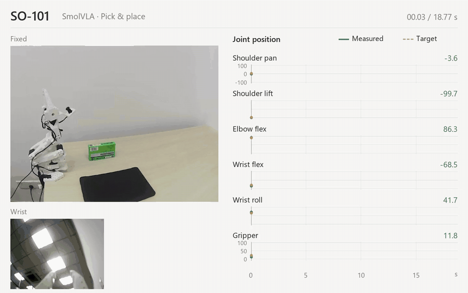
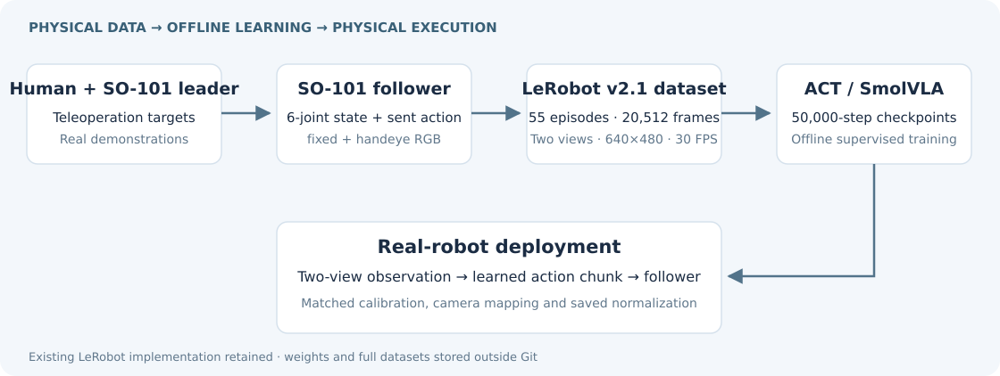
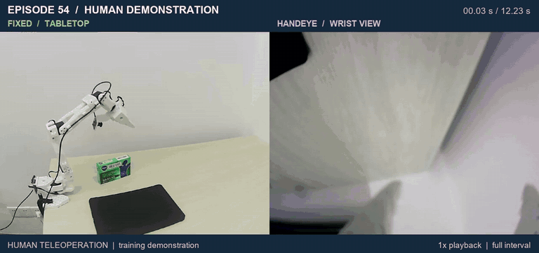
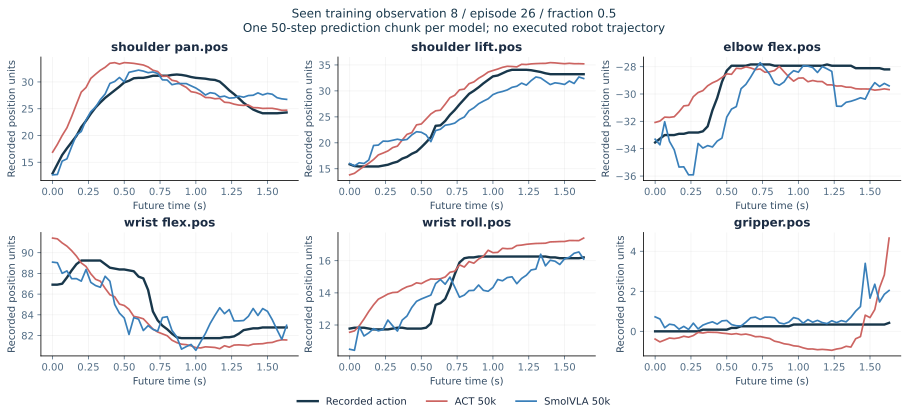
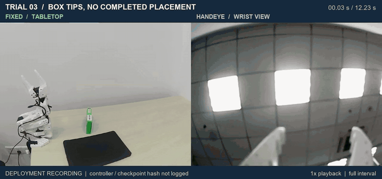

<h1 align="center">🤖 SO-101 Imitation Learning</h1>
<p align="center"><strong>Real-to-real · demonstrations, ACT / SmolVLA training, and robot deployment</strong></p>
<p align="center"><strong>English</strong> · <a href="README.zh-CN.md">简体中文</a></p>
<p align="center">
  
  
  
  
</p>

I used an SO-101 leader–follower pair and two RGB cameras to collect demonstrations for one task:

> Pick up the green medicine box and place it in the black target area.

ACT and SmolVLA were trained to **50,000 steps** on a remote GPU server. This repository contains the code, configurations, training logs, diagnostic results and selected robot recordings. ACT training and the deployment videos date to **September 29, 2026**; SmolVLA training and analysis date to **October 7–13, 2026**. The source was published in November. [Project history](docs/so101/provenance.md).

<p align="center"><strong>🧭 Contents</strong></p>
<p align="center">
  <a href="#demo"><strong>🎬&nbsp;Demo</strong></a> &nbsp;·&nbsp;
  <a href="#features"><strong>✨&nbsp;Features</strong></a> &nbsp;·&nbsp;
  <a href="#architecture"><strong>🧩&nbsp;Architecture</strong></a>
</p>
<p align="center">
  <a href="#collection"><strong>🎮&nbsp;Data&nbsp;collection</strong></a> &nbsp;·&nbsp;
  <a href="#training"><strong>🧠&nbsp;Training&nbsp;&amp;&nbsp;deployment</strong></a> &nbsp;·&nbsp;
  <a href="#remote-training"><strong>☁️&nbsp;Remote&nbsp;training</strong></a>
</p>
<p align="center">
  <a href="#results"><strong>📈&nbsp;Results</strong></a> &nbsp;·&nbsp;
  <a href="#quickstart"><strong>🚀&nbsp;Quick&nbsp;start</strong></a> &nbsp;·&nbsp;
  <a href="#structure"><strong>📂&nbsp;Project&nbsp;structure</strong></a> &nbsp;·&nbsp;
  <a href="#credits"><strong>📚&nbsp;Citation&nbsp;&amp;&nbsp;license</strong></a>
</p>

<a id="demo"></a>
## 🎬 Demo

<p align="center">
  <a href="media/so101/deployment-trial06-telemetry.mp4?raw=true"></a>
  <br><sub>Trial06 · deployment recording · full 18.77 s · 1× · no time cuts</sub>
</p>

[Watch / download MP4](media/so101/deployment-trial06-telemetry.mp4?raw=true)

The fixed camera shows the pick-and-place while the wrist view follows the gripper. Solid curves show measured joint positions; dashed curves show sent targets. These are normalized servo positions; current and torque were not recorded. The wrist recording ends at 14.20 s, and an ending card marks the missing interval.

The trial directory is named `050000`, but the command, model family and checkpoint hash were not saved. The clip is labeled **deployment recording** because its controller cannot be confirmed. [Recording details](docs/so101/evaluation.md#video-and-joint-motion).

<p align="center"></p>

<details>
<summary>🎥 More views and recordings</summary>

<p align="center">
  <a href="media/so101/deployment-trial06-two-view.mp4?raw=true"></a>
  <br><sub>Trial06 · two views · 18.77 s · 1× · missing wrist interval marked</sub>
</p>

[Two-view MP4](media/so101/deployment-trial06-two-view.mp4?raw=true) · [Native fixed-camera MP4](media/so101/deployment-trial06.mp4?raw=true) · [1280×960 display copy](media/so101/deployment-trial06-display-1280.mp4?raw=true). The display copy uses resizing and mild sharpening; the source is 640×480.

<p align="center">
  <a href="media/so101/deployment-trial04-two-view.mp4?raw=true"></a>
  <br><sub>Trial04 · deployment recording · 12.63 s · 1× · cable handling and human reset included</sub>
</p>

[Trial04 MP4](media/so101/deployment-trial04-two-view.mp4?raw=true). The controller/checkpoint identifiers are also missing for this recording. Both clips keep the complete saved interval.

</details>

<a id="features"></a>
## ✨ Main features

- Leader–follower demonstration collection with two camera streams and six-joint state/action recording.
- ACT with a ResNet-18 backbone and 100-step chunks; SmolVLA with image/state/task input and 50-step chunks.
- Local SmolVLA loading, offline checks and a live runner, plus the standard LeRobot rollout recorder.
- SO-101 serial retries, configurable OpenCV capture codec and empty-episode handling.
- Training curves, saved predictions and scripts to recompute the included metrics.

<a id="architecture"></a>
## 🧩 System architecture

<p align="center"></p>

| Component | Configuration |
| --- | --- |
| Robot | SO-101 follower; SO-101 leader for demonstrations |
| Views | `observation.images.fixed`, `observation.images.handeye` |
| Recording | RGB, 640×480, 30 FPS, AV1, no audio |
| State / action | Six joint positions |
| Dataset | LeRobot v2.1, per-episode Parquet and per-camera MP4 |
| Training | Remote Linux GPU server, batch size 4, seed 1000 |
| Local inference checks | Windows, Python 3.10, PyTorch 2.7.1 + CUDA 12.8, GTX 1650 Ti |

Camera assignment, joint order, calibration and model normalization must agree at deployment. See the [robot and model settings](docs/so101/deployment.md#configuration-contract).

<p align="center"></p>

The fixed view covers the workspace and target. The handeye view provides a closer view of the object during grasping.

<a id="collection"></a>
## 🎮 Data collection

The human moves the leader arm while the follower executes and LeRobot records the images, positions and targets actually sent to the motors.

<p align="center">
  <a href="media/so101/teleoperation-episode54.mp4?raw=true"></a>
  <br><sub>Human teleoperation · episode54 · full 12.23 s · 1× · no time cuts</sub>
</p>

[Demonstration MP4](media/so101/teleoperation-episode54.mp4?raw=true)

| Dataset | Value |
| --- | ---: |
| Demonstrations | 55 |
| Control frames | 20,512 |
| Camera videos | 110 |
| Total duration | 11.40 min |
| Episode duration | 9.30–13.37 s |
| Split | `train: 0:55` |

All Parquet files and video frame counts pass the [dataset audit](results/so101/dataset/audit.json). All 55 episodes were used for training. The complete dataset is excluded from Git. [Setup, calibration and collection commands](docs/so101/setup.md).

<a id="training"></a>
## 🧠 Training and deployment

| Setting | ACT | SmolVLA |
| --- | --- | --- |
| Final step | 50,000 | 50,000 |
| Action chunk | 100 | 50 |
| Batch size / seed | 4 / 1000 | 4 / 1000 |
| Learning rate | `1e-5` | `1e-4`, warmup + cosine decay |
| Image normalization | ImageNet mean/std | Identity at policy input; internal image processing |
| State / action normalization | Mean/std | Mean/std |
| Checkpoint interval | 10,000 | 5,000 |
| Task text | Not used | Recorded instruction |

<a id="remote-training"></a>
### ☁️ Remote GPU training

Collect on the robot computer, transfer the complete dataset, train on the server and bring back the numbered checkpoint. The [training guide](docs/so101/training.md) covers transfer, environment setup, pretrained assets, tmux, logs and resume.

```bash
python -m lerobot.scripts.train --config_path=configs/so101/train_act.json --output_dir=outputs/train/act_cloud_50k
python -m lerobot.scripts.train --config_path=configs/so101/train_smolvla.json --output_dir=outputs/train/smolvla_cloud_50k
```

Run the jobs separately on a single GPU. The original server GPU and full environment lock were not saved; the guide gives a compatible new-run recipe and distinguishes it from the archived settings.

For deployment, use `python -m lerobot.record --policy.path=...` to record a rollout, or `scripts/so101/run_policy.py` for local SmolVLA inference. The runner waits when generating each new chunk, so the requested 30 FPS is not a measured end-to-end control rate. [Offline checks and deployment](docs/so101/deployment.md).

<a id="results"></a>
## 📈 Experimental results

<p align="center"></p>

These diagnostics compare 50-step predictions against recorded actions at 15 observations from five training episodes. nMAE and nRMSE use each joint's training-action standard deviation.

| 50k checkpoint | nMAE ↓ | nRMSE ↓ | Mean joint R² ↑ |
| --- | ---: | ---: | ---: |
| ACT | 0.07877 | 0.13021 | 0.97642 |
| SmolVLA | 0.06887 | 0.12566 | 0.97702 |

The observations were seen during training. These scores measure action fitting, not physical success or generalization; the two loss objectives are plotted separately. [Methods and result files](docs/so101/evaluation.md).

<details>
<summary>📊 Six-joint predictions</summary>

<p align="center"></p>

The middle saved observation, from episode26 halfway through the episode. Both models predict the next 50 targets from the same input. These are offline predictions in recorded position units.

</details>

| Physical evaluation | Available record |
| --- | --- |
| Verified autonomous successes / attempts | — / — |
| Success protocol | Not recorded |
| Conditions | Same tabletop/target, varying box pose |
| Observed problems | Box tips, missed pickup, incomplete camera saves |
| Held-out split | None |

The recordings lack a complete attempt log and per-trial controller identifiers, so the success rate is left blank. [Trial inventory and evaluation protocol](docs/so101/evaluation.md#deployment-recordings).

<details>
<summary>⚠️ Failure recording</summary>

<p align="center">
  <a href="media/so101/deployment-trial03-two-view.mp4?raw=true"></a>
  <br><sub>Trial03 · deployment recording · full 12.23 s · 1× · no time cuts</sub>
</p>

[Trial03 MP4](media/so101/deployment-trial03-two-view.mp4?raw=true). The box tips without placement during the saved interval; a hand enters near the end. Controller identity is unconfirmed.

</details>

<a id="quickstart"></a>
## 🚀 Quick start

Use Python 3.10 and run from the repository root. Select a PyTorch wheel supported by your driver:

```bash
python -m pip install torch==2.7.1 torchvision==0.22.1 --index-url https://download.pytorch.org/whl/cu128
python -m pip install -e ".[feetech,smolvla]" -c requirements.txt
python -m pip check
python scripts/so101/verify_results.py
```

`requirements.txt` pins the checked model package versions; `pyproject.toml` defines core dependencies and optional extras. Add `.[tools]` for plots and video exports. Full demonstrations and weights are excluded: training needs a dataset, and inference needs the matching trained checkpoint and processor assets.

| Guide | Contents |
| --- | --- |
| [Setup](docs/so101/setup.md) | Install, ports/cameras, calibration, collection, audit and replay |
| [Training](docs/so101/training.md) | Remote GPU workflow, local commands, logs and resume |
| [Deployment](docs/so101/deployment.md) | Model assets, offline checks and live recording |
| [Results](docs/so101/evaluation.md) | Metrics, trial inventory and video processing |
| [Project history](docs/so101/provenance.md) | Dates, local changes and upstream attribution |

<a id="structure"></a>
## 📂 Project structure

```text
src/lerobot/       LeRobot source with local hardware changes
scripts/so101/    Inference, data audits, metrics and video tools
configs/so101/    Training recipes and checkpoint configurations
results/so101/    Logs, predictions, hashes and selected telemetry
media/so101/      Diagrams, plots and selected recordings
docs/so101/       Five guides linked above
```

The upstream examples, tests and benchmarks remain available. Generated outputs, environments, full datasets, weights and calibration files are ignored by Git.

<a id="credits"></a>
## 📚 Citation and license

Built on [Hugging Face LeRobot](https://github.com/huggingface/lerobot), [ACT / ALOHA](https://tonyzhaozh.github.io/aloha/) and [SmolVLA](https://huggingface.co/papers/2506.01844). The learning framework and model architectures come from upstream. This project adds the SO-101 experiment, hardware integration changes, deployment tools and recorded results.

The code uses [Apache-2.0](LICENSE), with upstream attribution in [NOTICE](NOTICE) and [project history](docs/so101/provenance.md#third-party-material). Downloaded model assets keep their own upstream terms.

```bibtex
@misc{turbo176_so101_imitation_learning_2026,
  author = {Turbo176},
  title = {SO-101 Imitation Learning: Physical Demonstrations, ACT and SmolVLA Training, and Robot Deployment},
  year = {2026},
  url = {https://github.com/Turbo176/SO101-Imitation-Learning},
  note = {Experiment records from September--October 2026}
}
```
