<h1 align="center">🤖 SO-101 模仿学习</h1>
<p align="center"><strong>Real-to-real · 真机示教、ACT / SmolVLA 训练与实机部署</strong></p>
<p align="center"><a href="README.md">English</a> · <strong>简体中文</strong></p>
<p align="center">
  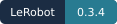
  
  
  
</p>

我使用一对 SO-101 主从臂和两路 RGB 相机采集示教，完成下面这个任务：

> 夹起绿色药盒，放到黑色目标区域。

ACT 和 SmolVLA 均在远程 GPU 服务器上训练到 **50,000 步**。仓库包含代码、配置、训练日志、离线分析结果和精选真机录像。ACT 训练记录与部署录像的日期为 **2026 年 9 月 29 日**；SmolVLA 的训练与分析记录来自 **2026 年 10 月 7–13 日**。源码于 11 月公开。[实验记录与来源](docs/so101/provenance.md)。

<p align="center"><strong>🧭 目录</strong></p>
<p align="center">
  <a href="#demo"><strong>🎬&nbsp;演示</strong></a> &nbsp;·&nbsp;
  <a href="#features"><strong>✨&nbsp;主要功能</strong></a> &nbsp;·&nbsp;
  <a href="#architecture"><strong>🧩&nbsp;系统架构</strong></a>
</p>
<p align="center">
  <a href="#collection"><strong>🎮&nbsp;数据采集</strong></a> &nbsp;·&nbsp;
  <a href="#training"><strong>🧠&nbsp;训练与部署</strong></a> &nbsp;·&nbsp;
  <a href="#remote-training"><strong>☁️&nbsp;远程训练</strong></a>
</p>
<p align="center">
  <a href="#results"><strong>📈&nbsp;实验结果</strong></a> &nbsp;·&nbsp;
  <a href="#quickstart"><strong>🚀&nbsp;快速运行</strong></a> &nbsp;·&nbsp;
  <a href="#structure"><strong>📂&nbsp;项目结构</strong></a> &nbsp;·&nbsp;
  <a href="#credits"><strong>📚&nbsp;引用与许可</strong></a>
</p>

<a id="demo"></a>
## 🎬 演示

<p align="center">
  <a href="media/so101/deployment-trial06-telemetry.mp4?raw=true">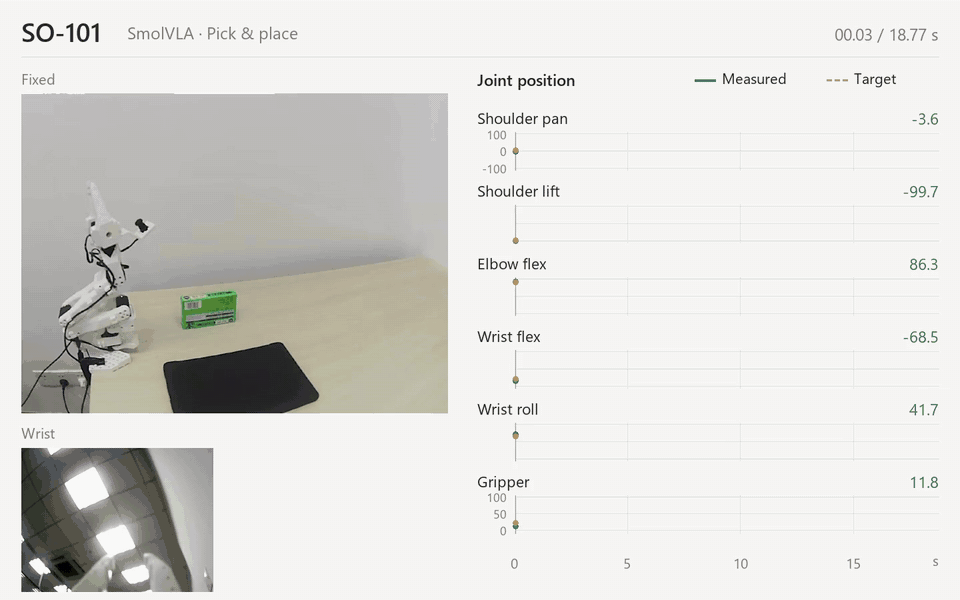</a>
  <br><sub>Trial06 · 部署录像 · 完整 18.77 秒 · 原速 1× · 未作时间剪辑</sub>
</p>

[观看 / 下载 MP4](media/so101/deployment-trial06-telemetry.mp4?raw=true)

固定相机拍摄抓取与放置过程，腕部相机跟随夹爪。实线表示实测关节位置，虚线表示实际发送的目标位置。曲线单位为归一化舵机位置，未记录电流或力矩。腕部录像在 14.20 秒结束，缺失部分已用结束画面标明。

录像目录名包含 `050000`，但当时没有保存运行命令、模型类型和 checkpoint 哈希，因此标注为**部署录像**，控制方式尚不能确认。[录像与曲线说明](docs/so101/evaluation.md#video-and-joint-motion)。

<p align="center">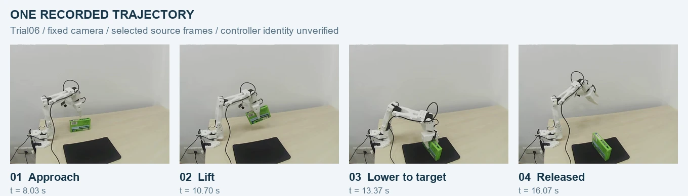</p>

<details>
<summary>🎥 更多视角与录像</summary>

<p align="center">
  <a href="media/so101/deployment-trial06-two-view.mp4?raw=true">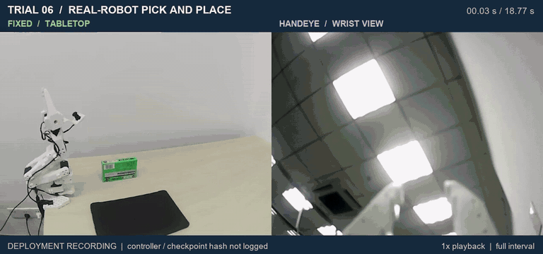</a>
  <br><sub>Trial06 · 双视角 · 18.77 秒 · 原速 1× · 腕部画面缺失区间已标明</sub>
</p>

[双视角 MP4](media/so101/deployment-trial06-two-view.mp4?raw=true) · [原始固定相机 MP4](media/so101/deployment-trial06.mp4?raw=true) · [1280×960 展示版](media/so101/deployment-trial06-display-1280.mp4?raw=true)。展示版仅做缩放和轻度锐化，原始分辨率为 640×480。

<p align="center">
  <a href="media/so101/deployment-trial04-two-view.mp4?raw=true">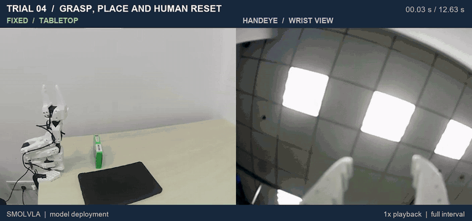</a>
  <br><sub>Trial04 · 部署录像 · 12.63 秒 · 原速 1× · 含人工整理线缆与复位</sub>
</p>

[Trial04 MP4](media/so101/deployment-trial04-two-view.mp4?raw=true)。这段录像同样缺少控制方式和 checkpoint 标识。两段视频均保留完整的已保存时段。

</details>

<a id="features"></a>
## ✨ 主要功能

- 主从臂示教采集，同时记录两路相机、六关节状态与动作。
- ACT 使用 ResNet-18 骨干网络和 100 步动作块；SmolVLA 使用图像、状态和任务文本，预测 50 步动作块。
- 本地 SmolVLA 加载、离线检查和真机运行脚本，以及 LeRobot 标准部署录像入口。
- SO-101 串口重试、可配置的 OpenCV 采集编码和空 episode 处理。
- 训练曲线、已保存的模型预测，以及结果复算脚本。

<a id="architecture"></a>
## 🧩 系统架构

<p align="center">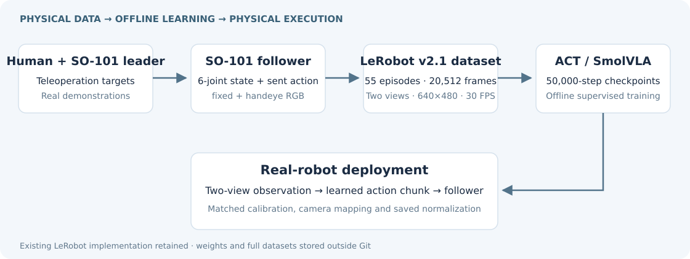</p>

| 组件 | 配置 |
| --- | --- |
| 机器人 | SO-101 从臂；示教时使用 SO-101 主臂 |
| 相机键名 | `observation.images.fixed`、`observation.images.handeye` |
| 录像格式 | RGB、640×480、30 FPS、AV1、无音频 |
| 状态 / 动作 | 六个关节的位置 |
| 数据集 | LeRobot v2.1，每个 episode 保存 Parquet 和两路 MP4 |
| 训练 | 远程 Linux GPU 服务器，batch size 4，seed 1000 |
| 本地推理检查 | Windows、Python 3.10、PyTorch 2.7.1 + CUDA 12.8、GTX 1650 Ti |

部署时，相机对应关系、关节顺序、机器人标定和模型归一化配置必须与训练一致。[机器人与模型配置](docs/so101/deployment.md#configuration-contract)。

<p align="center">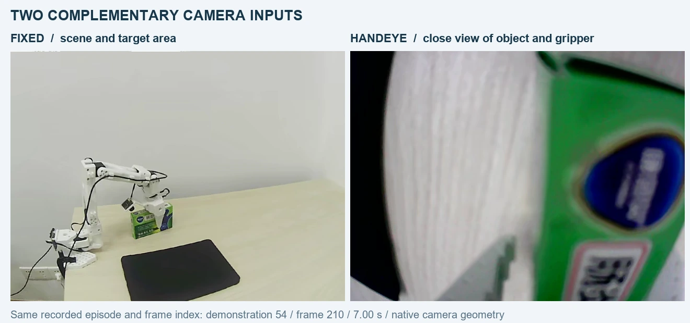</p>

固定视角覆盖工作台和目标区域，腕部视角提供抓取时的物体近景。

<a id="collection"></a>
## 🎮 数据采集

人工移动主臂，从臂跟随执行。LeRobot 同时记录图像、实测关节位置和实际发送给电机的目标位置。

<p align="center">
  <a href="media/so101/teleoperation-episode54.mp4?raw=true">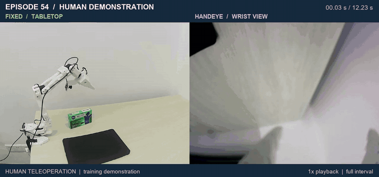</a>
  <br><sub>人工遥操作 · episode54 · 完整 12.23 秒 · 原速 1× · 未作时间剪辑</sub>
</p>

[示教 MP4](media/so101/teleoperation-episode54.mp4?raw=true)

| 数据集 | 数值 |
| --- | ---: |
| 示教次数 | 55 |
| 控制帧数 | 20,512 |
| 相机视频数 | 110 |
| 总时长 | 11.40 分钟 |
| 单次时长 | 9.30–13.37 秒 |
| 数据划分 | `train: 0:55` |

全部 Parquet 文件和视频帧数均通过[数据检查](results/so101/dataset/audit.json)。55 个 episode 全部用于训练，完整数据集不包含在 Git 仓库中。[安装、标定与采集命令](docs/so101/setup.md)。

<a id="training"></a>
## 🧠 训练与部署

| 设置 | ACT | SmolVLA |
| --- | --- | --- |
| 最终训练步数 | 50,000 | 50,000 |
| 动作块长度 | 100 | 50 |
| Batch size / seed | 4 / 1000 | 4 / 1000 |
| 学习率 | `1e-5` | `1e-4`，预热后余弦衰减 |
| 图像归一化 | ImageNet mean/std | 策略输入不做归一化，由模型内部处理图像 |
| 状态 / 动作归一化 | Mean/std | Mean/std |
| Checkpoint 保存间隔 | 10,000 步 | 5,000 步 |
| 任务文本 | 不使用 | 使用采集时记录的指令 |

<a id="remote-training"></a>
### ☁️ 远程 GPU 训练

在机器人电脑上采集，传输完整数据集到服务器，训练后将指定步数的 checkpoint 下载回来。[训练文档](docs/so101/training.md)包含数据传输、环境配置、预训练资源、tmux、日志和断点续训。

```bash
python -m lerobot.scripts.train --config_path=configs/so101/train_act.json --output_dir=outputs/train/act_cloud_50k
python -m lerobot.scripts.train --config_path=configs/so101/train_smolvla.json --output_dir=outputs/train/smolvla_cloud_50k
```

单张 GPU 上分别运行两个任务。原始服务器 GPU 型号和完整依赖锁定文件未保存；文档给出了兼容的重新训练步骤，并与存档配置分别说明。

部署录像使用 `python -m lerobot.record --policy.path=...`，本地 SmolVLA 推理也可使用 `scripts/so101/run_policy.py`。该脚本同步生成动作块，生成期间会等待，因此配置中的 30 FPS 不代表实测的端到端控制频率。[离线检查与部署](docs/so101/deployment.md)。

<a id="results"></a>
## 📈 实验结果

<p align="center">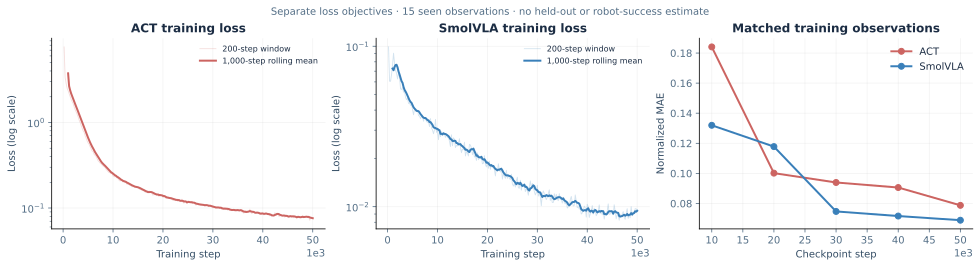</p>

下面的离线分析使用五个训练 episode 中的 15 个观测点，将模型预测的 50 步动作与记录动作进行比较。nMAE 和 nRMSE 均按各关节训练动作的标准差进行归一化。

| 50k checkpoint | nMAE ↓ | nRMSE ↓ | 六关节平均 R² ↑ |
| --- | ---: | ---: | ---: |
| ACT | 0.07877 | 0.13021 | 0.97642 |
| SmolVLA | 0.06887 | 0.12566 | 0.97702 |

这些观测在训练中已使用，分数反映动作拟合情况，不能代表实机成功率或泛化能力。两个模型的损失定义不同，因此分别绘图。[计算方法与结果文件](docs/so101/evaluation.md)。

<details>
<summary>📊 六关节预测</summary>

<p align="center">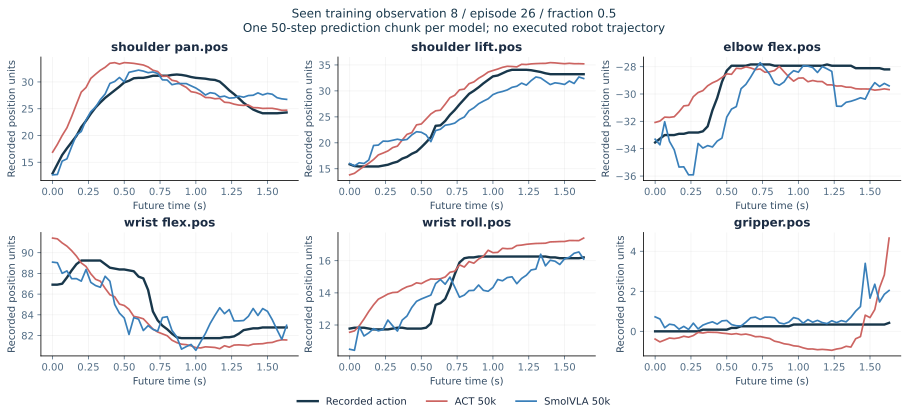</p>

图中选取已保存观测中的中间一组，即 episode26 的中段。两个模型使用相同输入，预测之后 50 步的目标位置。此处为离线预测，单位与记录的关节位置一致。

</details>

| 实机评测 | 现有记录 |
| --- | --- |
| 已核实的自主成功数 / 尝试数 | — / — |
| 成功判定标准 | 未记录 |
| 任务条件 | 相同工作台和目标区域，改变药盒姿态 |
| 观察到的问题 | 药盒翻倒、未夹起、相机保存不完整 |
| 独立测试集 | 无 |

现有录像缺少完整尝试日志和逐次控制方式标识，因此成功率留空。[录像清单与评测方法](docs/so101/evaluation.md#deployment-recordings)。

<details>
<summary>⚠️ 失败录像</summary>

<p align="center">
  <a href="media/so101/deployment-trial03-two-view.mp4?raw=true">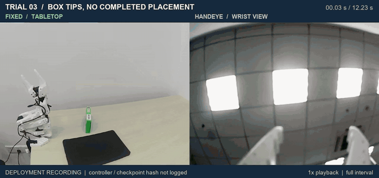</a>
  <br><sub>Trial03 · 部署录像 · 完整 12.23 秒 · 原速 1× · 未作时间剪辑</sub>
</p>

[Trial03 MP4](media/so101/deployment-trial03-two-view.mp4?raw=true)。保存时段内药盒翻倒，未完成放置，末段有人手进入画面。控制方式尚未确认。

</details>

<a id="quickstart"></a>
## 🚀 快速运行

使用 Python 3.10，在仓库根目录运行。PyTorch 安装源需与显卡驱动兼容：

```bash
python -m pip install torch==2.7.1 torchvision==0.22.1 --index-url https://download.pytorch.org/whl/cu128
python -m pip install -e ".[feetech,smolvla]" -c requirements.txt
python -m pip check
python scripts/so101/verify_results.py
```

`requirements.txt` 固定已检查的模型依赖版本；`pyproject.toml` 定义核心依赖和可选功能。生成曲线和视频时，额外安装 `.[tools]`。完整示教数据与权重不包含在仓库中：训练需要数据集，推理需要对应的已训练 checkpoint 和处理器资源。

下面的详细文档使用英文，命令和参数名与代码一致。

| 文档 | 内容 |
| --- | --- |
| [安装与采集](docs/so101/setup.md) | 安装、串口 / 相机、标定、采集、数据检查和回放 |
| [训练](docs/so101/training.md) | 远程 GPU 流程、本地命令、日志和断点续训 |
| [部署](docs/so101/deployment.md) | 模型资源、离线检查和实机录像 |
| [实验结果](docs/so101/evaluation.md) | 指标、录像清单和视频处理 |
| [实验记录与来源](docs/so101/provenance.md) | 日期、代码改动和上游署名 |

<a id="structure"></a>
## 📂 项目结构

```text
src/lerobot/       LeRobot 源码，包含本地硬件适配改动
scripts/so101/    推理、数据检查、指标与视频工具
configs/so101/    训练配置与 checkpoint 配置
results/so101/    日志、预测、哈希与精选遥测数据
media/so101/      架构图、曲线与精选录像
docs/so101/       上表中的五份文档
```

上游示例、测试和基准工具仍保留。生成结果、环境、完整数据集、权重和标定文件均由 Git 忽略。

<a id="credits"></a>
## 📚 引用与许可

基于 [Hugging Face LeRobot](https://github.com/huggingface/lerobot)、[ACT / ALOHA](https://tonyzhaozh.github.io/aloha/) 和 [SmolVLA](https://huggingface.co/papers/2506.01844)。学习框架与模型架构来自上游，本项目包含 SO-101 实验、硬件适配改动、部署工具和实验记录。

代码采用 [Apache-2.0](LICENSE) 许可，上游署名见 [NOTICE](NOTICE) 和[第三方材料说明](docs/so101/provenance.md#third-party-material)。另行下载的模型资源遵循各自的上游条款。

```bibtex
@misc{turbo176_so101_imitation_learning_2026,
  author = {Turbo176},
  title = {SO-101 Imitation Learning: Physical Demonstrations, ACT and SmolVLA Training, and Robot Deployment},
  year = {2026},
  url = {https://github.com/Turbo176/SO101-Imitation-Learning},
  note = {Experiment records from September--October 2026}
}
```
